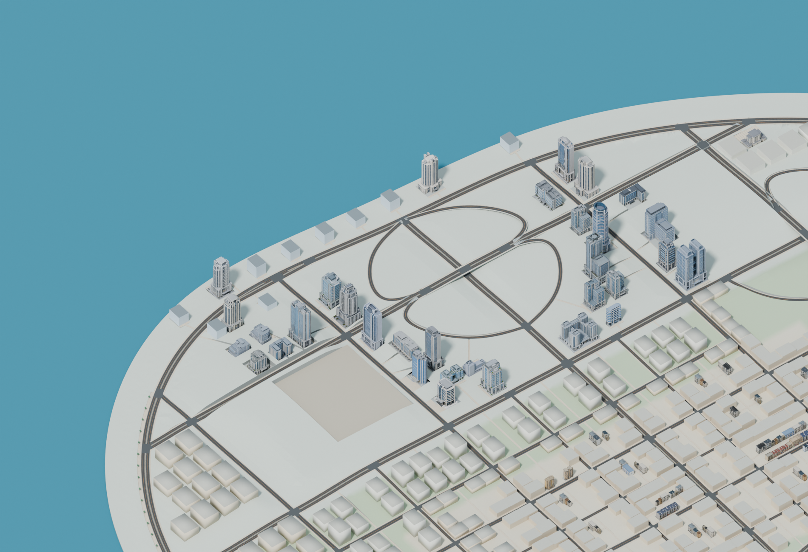
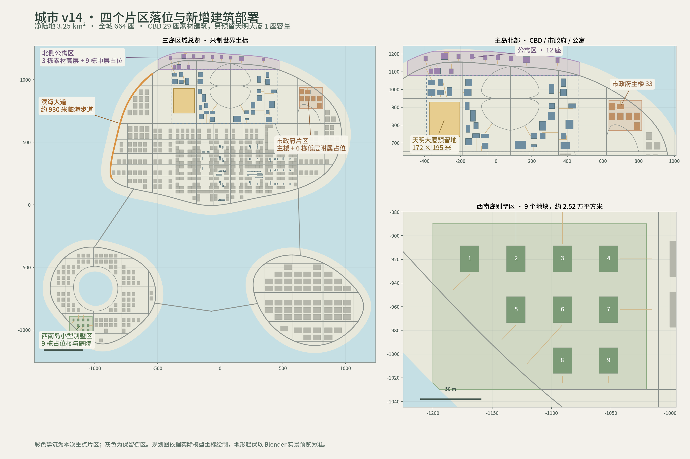

# 城市 v14 · 四个片区与 19 个建筑素材

本次只交付 **01、05、06、07、08、09 六个修改区块**，其他 12 个区块继续使用 v13。初始基准为 [city_v13](../../city_v13/README.md)，几何基准提交 `0a2235ddb51c6cc5f29cf8c53b6bfa609cd11b3a`。

全城现有 **664 座**：124 个素材实例、540 个占位楼。净陆地仍为 **3.25 km²**，原道路和岸线保留。CBD 现有 **29 座，全部已用素材建筑替换**，天明大厦仍保留 172×195 米空地，未来放入后 CBD 合计 30 座。

## 片区结果

- **东侧市政府片区**：33 号政府楼使用一次，建立前广场和步行入口；6 栋附属占位楼降为 9.6–12 米，保持主楼识别度。
- **西侧滨海大道**：沿现有西岸环路增加约 930 米临海步道，海侧人行道总宽约 7 米，保留至少 4.5 米走行带，增加 32 株占位行道树及栏杆。
- **北侧公寓区**：3 栋上传的高层按服务式公寓部署，另加入 9 栋中层占位楼，共 12 座。
- **西南岛别墅区**：划定约 2.52 万平方米陆地，9 个村镇地块改为 16×22 米、8.4 米高的别墅占位楼，配庭院和步行入口。未提供别墅素材，当前仍为占位体块。

19 个输入文件各使用一次，朝向为南 6、北 6、东 3、西 4。玻璃楼 41/42、办公楼 42/43 各为一对几何与贴图相同的文件，分别按其文件身份布置；没有把它们误计为四种不同几何。

## 需要替换的区块

| 区块 | 文件 | 建筑数量 v13 → v14 | 修改内容 |
| --- | --- | ---: | --- |
| 01 | `01_main_sw.glb` | 44 → 44 | 滨海大道南段：扩出临海步道，增加行道树与栏杆，连接现有人行道。 |
| 05 | `05_main_nw.glb` | 12 → 12 | 滨海大道北段：与 01 区块共同形成约 930 米连续步道。 |
| 06 | `06_main_north_west_center.glb` | 15 → 23 | 替换西侧 8 个 CBD 占位楼；加入 2 栋公寓高层和 6 栋中层占位楼，适配入口与坡地。 |
| 07 | `07_main_north_east_center.glb` | 16 → 20 | 替换东侧 7 个 CBD 占位楼；加入 1 栋公寓高层和 3 栋中层占位楼，适配入口与坡地。 |
| 08 | `08_main_ne.glb` | 10 → 10 | 政府 33 号主楼替换一个市政占位楼，建立前广场；6 栋附属占位楼降低至 9.6–12 米。 |
| 09 | `09_west_sw.glb` | 20 → 20 | 9 个原村镇地块改为别墅占位楼、庭院和步行入口，保持建筑数量。 |

01/05 的滨海步道、06/07 的北侧边界需要配套更新；这六个区块构成同一次完整增量，不要遗漏其中一项。公共桥梁 17 和水域 18 保持 v13。

## 合并与替换

保留 v13 原文件，下载本目录及 `districts/` 下的 **37 个分卷**。每个区块单独压缩和拆分，没有整城分卷包；分卷总计 **279.94 MB**，恢复后六个 GLB 合计 **338.01 MB**，均内嵌贴图。

```bash
python3 delivery/city_updates/v14_20261029/reassemble.py --baseline-dir /path/to/v13/districts --out /path/to/v14/districts
```

脚本先验证全部 18 个 v13 文件，再逐区块验证分卷、压缩文件和 GLB 的 SHA256，最后组合出完整 18 区块集合，保留原基准不变。不提供 `--baseline-dir` 时只恢复本次六个 GLB，可用于手动替换。

Blender / 引擎中移除旧的对应区块，再导入新版本；保持根位置、旋转为零，缩放为 1，保持世界坐标。整城 GLB 与区块集合选用一种加载方式，避免叠加。

各文件原始/新校验值、大小、基准版本和当前全部 18 个区块来源见 [manifest.json](manifest.json)。全部 664 座建筑的清单及新素材来源见 [metadata](metadata/)。

## 验证与预览

37 条新增步行连接通过地面、接缝和净空检查；最大新增入口坡度约 **7.90%**，新旧人行道接缝最大约 **1.48 mm**。6402 个道路采样和原 39 条步行巷道通过；两处立交最小实际净空仍约 **8.22 米**。天明预留地 1365 个采样点保持平整、无建筑占用。

整套 18 区块重新导入，**3,132,176 个三角面**分配完整，124 个素材实例均只分配一次，最大世界坐标误差 **0 米**，内嵌贴图校验通过。详情见 [validation](validation/)。交付为静态模型；游戏碰撞、导航、流式加载及实机帧率不在本次验证范围。

[六张 Blender 实际渲染和一张精确规划图](previews/)；[素材部署表及复现步骤](REPRODUCE.md)。





道路素材 Road Modular：mortalityrexotable，CC BY 4.0，原授权见 v13 `source/ROAD_ASSET_LICENSE.md`。建筑沿用用户提供素材的原授权。
